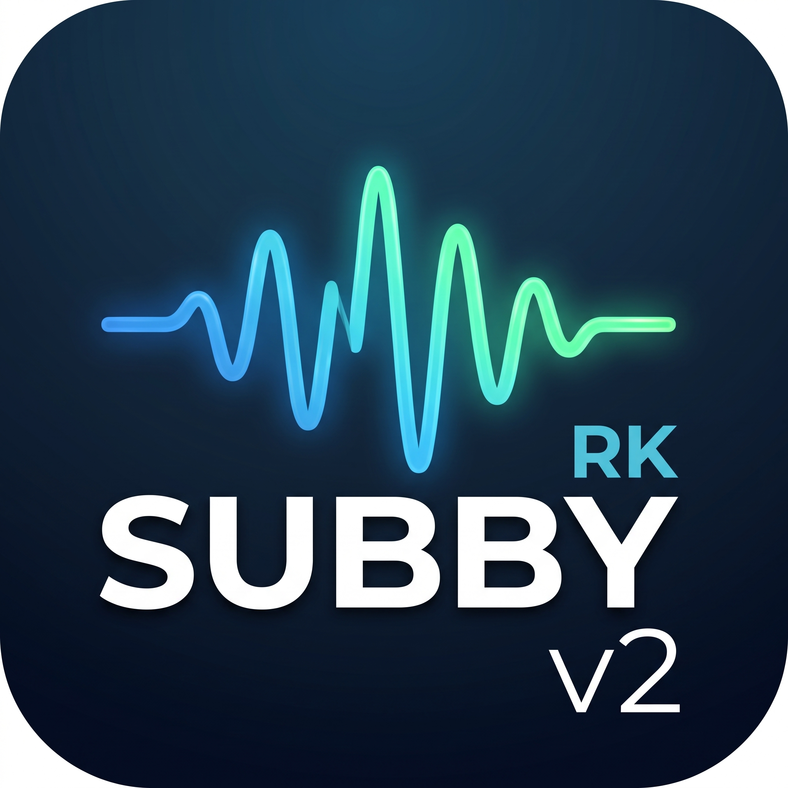

<p align="center"></p>

# rksubbyV2 – élő magyar felirat angol beszédhez (Xbox + OBS)

> **English summary:** rksubbyV2 turns English speech from a console (or any HDMI source captured in OBS) into live Hungarian subtitles. Speech is detected with Silero VAD, transcribed locally with faster-whisper on the GPU, translated with the DeepL API (with context from the previous lines), and shown in OBS through a browser source served by the script itself. Typical delay from the end of a sentence to the Hungarian subtitle: about 0.6–0.8 s on an RTX 3090.

Az Xboxon (vagy bármilyen, OBS-be behúzott HDMI-forráson) futó angol beszédet élőben magyar felirattá alakítja, és a felirat az OBS-ben a játékkép fölött jelenik meg.

## Mit tud

- **Mondatokat fordít, nem darabokat.** A Silero VAD 32 ms-onként figyeli, mikor kezdődik és ér véget a beszéd, így a felismerés egész mondatokat kap, és nem vág bele a szavakba.
- **Gyors.** Már a csend elején elindul a végleges felismerés és a fordítás. Mondatvégi írásjelnél 250 ms szünet után lezár, folyamatos beszédnél pedig a kész mondatokat menet közben kiküldi, a fordításukat előre elindítva.
- **Értelmes fordítás.** A DeepL megkapja az előző három mondatot kontextusnak, és tegező hangnemet kér, ami a játékpárbeszédekhez illik.
- **Helyi felismerés.** A beszédfelismerés a gépeden fut (faster-whisper, `distil-large-v3`), csak a kész angol szöveg megy a DeepL-hez.
- **Kiszűri a zajt.** A Whisper tipikus kitalált mondatai csendre vagy zajra („Thank you.”, „Subtitles by…”) nem kerülnek ki.
- **OBS-be egyszerűen.** A script maga szolgálja ki a feliratot: a böngészőforrás URL-je `http://127.0.0.1:8765/`. Nincs fájlfigyelés és fájlzárolás.
- **Látszik, mi történik.** Induláskor lépésenként kiírja, hol tart. Ha nincs felirat, időnként a hangszintet is jelzi, „NEM JÖN HANG” esetén nem érkezik hang a kábelről. Minden mondat bekerül a `sub_log.tsv` naplóba a felismerési és fordítási idővel, valamint a késéssel.
- **NVIDIA nélkül is elindul.** CPU-n kisebb modellel fut, lassabban.

## Hogyan működik

```
Xbox -> capture kártya -> OBS --(hangfigyelés)--> VB-CABLE --> rksubby.py
                                                                 | Silero VAD  -> mondatok
                                                                 | faster-whisper (GPU) -> angol szöveg
                                                                 | DeepL -> magyar szöveg
OBS böngészőforrás  <---  http://127.0.0.1:8765/  <--------------+
```

## Mért teljesítmény

RTX 3090, `distil-large-v3`, DeepL API Free, élő angol YouTube-videó az Xboxon (2026. október):

| | |
|---|---|
| Mondat vége → magyar felirat (medián, 143 mondat) | **~0,8 mp** |
| Szünettel záruló mondatoknál | 0,55–0,7 mp |
| Gyors, szünet nélküli beszédnél | 1,5–2,5 mp |
| Beszédfelismerés mondatonként | ~150–230 ms |
| DeepL-fordítás mondatonként | ~300 ms |
| Indulás (meleg / hidegindítás) | ~7–9 mp / ~40 mp |

## Követelmények

- Windows 10 vagy 11
- Python 3.10–3.12 (64 bites)
- NVIDIA videokártya, ajánlott (6+ GB VRAM). Nélküle is elindul CPU-n, de lassabb és pontatlanabb.
- OBS Studio 30 vagy újabb
- [VB-Audio Virtual Cable](https://vb-audio.com/Cable/) (ingyenes)
- DeepL API Free kulcs (ingyenes, havi karakterkerettel; a regisztrációnál a DeepL bankkártyás azonosítást kér)

## Telepítés

1. Telepítsd a Pythont (python.org vagy Microsoft Store). A python.org-os telepítőnél pipáld be az „Add Python to PATH” opciót.
2. Töltsd le a projektet (a GitHub-oldalon a zöld **Code** gomb → **Download ZIP**), és csomagold ki egy olyan helyre, amelynek az útvonalában **nincs ékezet**, például `E:\rksubbyV2`.
3. Futtasd az `install.bat`-ot. Telepíti a csomagokat, és megkérdezi, van-e NVIDIA kártyád.
   Kézzel: `python -m pip install -r requirements.txt`, NVIDIA-hoz még `python -m pip install -r requirements-gpu.txt`.
4. Telepítsd a VB-Audio Virtual Cable-t, aztán indítsd újra a gépet.

Az első indításkor a script letölti a felismerő modellt (kb. 1,5 GB, egyszeri).

## OBS beállítása

1. **Hova menjen a hang:** Beállítások → Hang → Speciális → **Hangfigyelő eszköz: CABLE Input (VB-Audio Virtual Cable)**.
2. **A játék hangja:** a Hangkeverőben a capture-forrás melletti ⋮ → Speciális hangtulajdonságok. A capture-forrásnál a Hangfigyelés legyen **„Figyelés és kimenet”**, az **Asztali hangnál „Figyelés kikapcsolása”**, különben visszhang és hurok keletkezhet.
3. **A felirat:** adj hozzá egy új **Böngészőforrást**, a „Helyi fájl” legyen **kikapcsolva**, a **Webcím `http://127.0.0.1:8765/`**, a méret 1920×1080. A forrás a lista tetején legyen, a játékkép fölött.

A felirat csak akkor látszik, ha fut a script.

Ha a játék hangját a gépen is hallani szeretnéd: Windows Hang (`mmsys.cpl`) → Felvétel → CABLE Output → Tulajdonságok → Figyelés → „Az eszköz figyelése” → válaszd a hangszóródat.

## DeepL-kulcs

1. Regisztrálj a DeepL API Free csomagra: <https://www.deepl.com/pro-api>.
2. Másold ki a kulcsot: <https://www.deepl.com/your-account/keys>. A Free kulcs vége `:fx`.
3. Indítsd el a scriptet. Az első indításkor megtalálja a kulcsot a vágólapon, és csak egy Entert kér. Később így cserélheted: `python rksubby.py --deepl-key`.

A kulcs a felhasználói mappádba kerül (`%USERPROFILE%\.rksubby\deepl_key.txt`), **nem** a projektmappába, így nem adod tovább véletlenül.

## Indítás

- `start.bat`, vagy parancssorból: `python rksubby.py`
- Próba Xbox nélkül, egy rövid angol felvétellel: `python rksubby.py --wav teszt_angol.wav`
- Csak a fordító tesztje (pár másodperc): `python rksubby.py --test-translate`

A konzolon minden mondat megjelenik angolul és magyarul, a felismerési és fordítási idővel és a késéssel együtt. Kilépés: Ctrl+C.

## Beállítások

A beállítások az `rksubby.py` elején vannak, magyarázattal. A fontosabbak:

| Beállítás | Mit csinál |
|---|---|
| `GAME_HOTWORDS` | Nevek, helyek, amiket a felismerés jobban eltalál (pl. GTA VI: `"Jason, Lucia, Vice City, Leonida"`) |
| `MODEL_NAME` | Felismerő modell (alap: `distil-large-v3`; alternatíva: `large-v3-turbo`) |
| `END_SILENCE_MS`, `SPECULATIVE_SILENCE_MS` | Mennyi csend után zárja le a mondatot (450 ms, írásjelnél 250 ms) |
| `MAX_LINES`, `SUB_MIN_S`, `SUB_MAX_S` | Hány sor látszik egyszerre, és meddig marad kint egy felirat |
| `SHOW_PARTIAL_EN` | Beszéd közben szürke angol előnézet (alapból kikapcsolva) |
| `SHOW_EN_UNDER_HU` | A magyar alatt kicsiben az angol eredeti is |
| `DEEPL_FORMALITY` | Tegező (`prefer_less`) vagy magázó (`prefer_more`) hangnem |
| `OBS_HTTP_PORT` | A felirat-webszerver portja (alap: 8765) |

A felirat kinézete (sárga, 32 px, fekete körvonal) a scriptben az `OVERLAY_HTML` résznél állítható, vagy az OBS böngészőforrásának „Egyéni CSS” mezőjében.

## Hibaelhárítás

**„NEM JÖN HANG” a konzolon.** Nem érkezik hang a CABLE Outputról.
- Ellenőrizd az OBS-beállítás 1. és 2. lépését.
- **Fontos:** Windows-frissítés vagy illesztőprogram-csere után az OBS megtarthat egy már nem létező eszközazonosítót. Ilyenkor a beállításban továbbra is „CABLE Input” látszik, de nem megy hang. Az OBS naplójában ilyenkor ez áll: `audio_monitor_init_wasapi: Failed to get device`. Megoldás: a Hangfigyelő eszköznél válassz ki egy másikat, nyomd meg az Alkalmaz gombot, aztán válaszd vissza a CABLE Inputot, és megint Alkalmaz.
- Ellenőrzés: Windows Hang (`mmsys.cpl`) → Felvétel. A CABLE Output szintjelzőjének mozognia kell, miközben szól a játék.

**A felirat nem látszik az OBS-ben, pedig a konzolon megjelenik.**
- A böngészőforrás URL-je `http://127.0.0.1:8765/` legyen, a „Helyi fájl” kikapcsolva.
- Ha az OBS naplójában `CEF failed to initialize` áll, zárd be teljesen az OBS-t, és indítsd újra. Soha ne fusson egyszerre két OBS.

**„Az OBS-felirat webszervere nem indult (port 8765)”.** Valami más használja a portot, vagy már fut egy példány a scriptből. Állíts be másik `OBS_HTTP_PORT`-ot, és írd át az OBS-ben is a webcímet.

**DeepL-hibák.** 403: rossz a kulcs, futtasd a `python rksubby.py --deepl-key` parancsot. 456: elfogyott a havi keret, ilyenkor a hónap végéig angol felirat jelenik meg.

**„A GPU-s betöltés nem sikerült … cublas”.** Hiányoznak a CUDA-könyvtárak: `python -m pip install -r requirements-gpu.txt`.

## Adatvédelem

A beszédfelismerés helyben fut, csak a felismert angol szöveg megy a DeepL-hez. A `sub_log.tsv` helyben tárolja a felismert mondatokat; ha nem kell, törölheted, továbbadás előtt pedig hagyd ki.

## Felhasznált projektek

[faster-whisper](https://github.com/SYSTRAN/faster-whisper) (MIT), [Whisper](https://github.com/openai/whisper) és [distil-whisper](https://github.com/huggingface/distil-whisper) modellek, [Silero VAD](https://github.com/snakers4/silero-vad) (MIT), [DeepL API](https://www.deepl.com/pro-api), [OBS Studio](https://obsproject.com), [VB-Audio Virtual Cable](https://vb-audio.com/Cable/).
A `teszt_angol.wav` J. F. Kennedy 1961-es beiktatási beszédéből származik (közkincs).

Fejlesztés: RKnoise, Claude (Anthropic) segítségével.

## Licenc

MIT, lásd a `LICENSE` fájlt.
